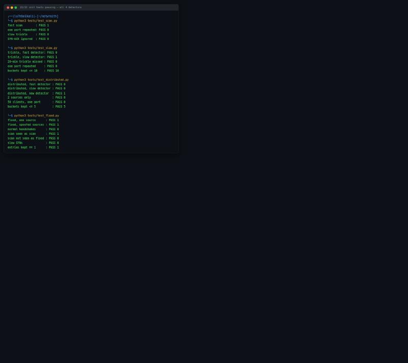
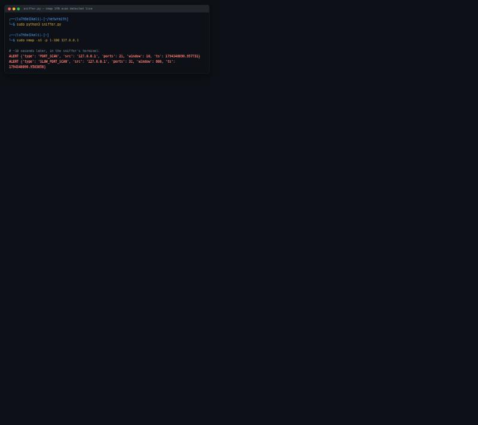
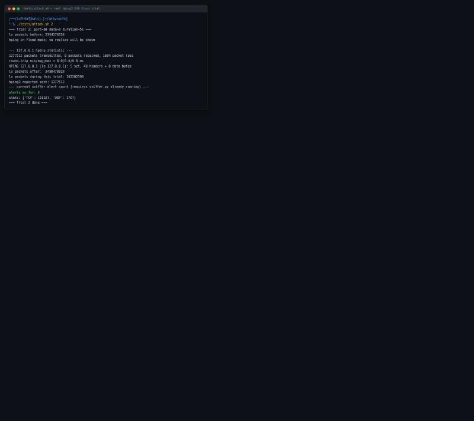
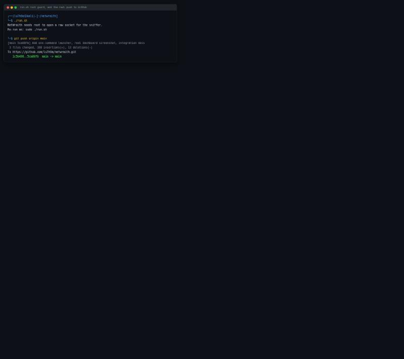

# NetWraith

A packet sniffer and intrusion detector for Linux, built from scratch in Python 3 with **no frameworks** — no Scapy, no Flask, no third-party dependencies. Raw sockets, hand-decoded Ethernet/IPv4/TCP/UDP headers, and four independent detection algorithms for port scans and SYN floods.


*Real screenshot — the dashboard reading `alerts.json`, populated during live testing against this project's own sniffer.*

## Table of contents

- [What it does](#what-it-does)
- [Architecture](#architecture)
- [How it works](#how-it-works)
  - [1. Packet capture](#1-packet-capture)
  - [2. Header decoding, byte by byte](#2-header-decoding-byte-by-byte)
  - [3. Detection algorithms](#3-detection-algorithms)
  - [4. Alert pipeline](#4-alert-pipeline)
- [Running it](#running-it)
- [Why a SYN scan looks different from a SYN flood](#why-a-syn-scan-looks-different-from-a-syn-flood)
- [Test results](#test-results)
- [Ways to use this](#ways-to-use-this)
- [Integrating it into your own app or site](#integrating-it-into-your-own-app-or-site)
- [Known limitations](#known-limitations)
- [Stack](#stack)
- [Responsible use](#responsible-use)
- [Contributing and security](#contributing-and-security)
- [License](#license)

## What it does

NetWraith opens a raw `AF_PACKET`/`SOCK_RAW` socket, decodes every header field by hand with `struct.unpack` (down to testing a single TCP flag bit with a bitmask), and runs four independent detectors over the live traffic:

- **Fast port-scan detector** — sliding 10-second window, alerts past 20 distinct destination ports from one source.
- **Slow port-scan detector** — 1-minute buckets over a 10-minute window, catches a patient attacker who stays under the fast detector's radar.
- **Distributed port-scan detector** — groups by *target* instead of *attacker*; alerts when ≥5 distinct sources collectively touch >30 ports on one victim within 5 minutes, catching a coordinated multi-IP sweep that no single source would trigger alone.
- **SYN-flood detector** — tracks unanswered SYNs keyed per-service and globally, so it catches both a flood from one real IP and a spoofed flood spread across thousands of fake source addresses.

Alerts are written atomically to `alerts.json` (temp file + `os.replace`, so readers never see a half-written file), and `dashboard.html` polls that file every 2 seconds to show a live table in light or dark theme.

## Architecture

```
 Network interface
        │
        ▼
 sniffer.py  ──  raw socket, recvfrom()
        │
        ▼
 parse_packet()  ──  Ethernet → IPv4 → TCP/UDP, by hand
        │
        ├──────────────▶ packets.jsonl   (one JSON line per packet)
        │
        ▼
 4 detectors get every packet:
   ScanDetector · SlowScanDetector · DistributedScanDetector · FloodDetector
        │
        ▼
 alerts.json  ──  atomic write (tmp file + os.replace)
        │
        ▼
 dashboard.html  ──  fetch() every 2s, renders table, light/dark theme
        │
        ▼
 served by: python3 -m http.server
```

## How it works

### 1. Packet capture

`sniffer.py` opens a Linux raw socket:

```python
s = socket.socket(socket.AF_PACKET, socket.SOCK_RAW, socket.ntohs(0x0003))
```

- **`AF_PACKET`** gives link-layer access — the kernel hands over each frame exactly as it arrived on the wire, headers included, instead of the already-parsed stream a normal `AF_INET` socket gives you.
- **`SOCK_RAW`** means no protocol processing is done for you — decoding is entirely the caller's responsibility.
- **`socket.ntohs(0x0003)`** requests `ETH_P_ALL` (all EtherTypes) in network byte order, so the socket sees every frame, not just one protocol.
- A loop calls `s.recvfrom(65535)` continuously; each call blocks until one frame arrives.

This needs root, because arbitrary raw packet capture is a privileged operation on Linux.

### 2. Header decoding, byte by byte

Every field is read with `struct.unpack` against an explicit format string — nothing is inferred or hidden by a library. A real captured SYN packet (74 bytes total) breaks down as:

```
offset  bytes                                   meaning
0-5     4c 06 17 03 01 f0                       destination MAC (next-hop router)
6-11    xx:xx:xx:xx:xx:xx                       source MAC (this host's interface)
12-13   08 00                                   EtherType: 0x0800 = IPv4

14      45                                       version=4, IHL=5 → 20-byte IPv4 header
15      00                                       type of service
16-17   00 3c                                   total length = 60
18-21   .. .. .. ..                              identification, flags, fragment offset
22      40                                       TTL = 64
23      06                                       protocol = 6 (TCP)
24-25   .. ..                                    header checksum
26-29   c0 a8 01 07                             source IP
30-33   68 14 17 9a                             destination IP

34-35   d0 a0                                    TCP source port
36-37   00 50                                    TCP destination port = 80
38-41   .. .. .. ..                              sequence number (random 32-bit ISN)
42-45   00 00 00 00                              ack number = 0 (none yet)
46      50                                        data offset = 5 words = 20-byte TCP header
47      02                                        flags = 0x02 = SYN only
48-73   ...                                       window, checksum, urgent pointer, TCP options
```

`14 (Ethernet) + 20 (IPv4, IHL×4) + 40 (TCP incl. options) = 74 bytes`, matching the frame's actual length exactly. The decoding logic in `parse_packet()`:

1. Slice off the first 14 bytes, unpack with `"!6s6sH"` (destination MAC, source MAC, EtherType). Stop here if EtherType isn't `0x0800` (IPv4) — this sniffer does not decode IPv6 or ARP.
2. Unpack the next 20 bytes with `"!BBHHHBBH4s4s"` to get version/IHL, TTL, protocol, and the source/destination IP. `IHL` is in 4-byte words, so the real header length is `IHL × 4` — options can make this larger than 20, so the TCP/UDP offset is always computed, never assumed fixed.
3. If `protocol == 6` (TCP), unpack 20 more bytes with `"!HHIIBBHHH"` for ports, sequence/ack numbers, and the flags byte. If `protocol == 17` (UDP), unpack 8 bytes with `"!HHHH"` instead.
4. TCP flags are tested with bitmasks against the single flags byte: `FIN=0x01, SYN=0x02, RST=0x04, PSH=0x08, ACK=0x10`. A "SYN-only" packet (not a SYN-ACK) is `(flags & 0x12) == 0x02` — masking down to just the SYN/ACK bits and requiring exactly SYN set.
5. The result is a plain dict (`ts`, `src`, `dst`, `proto`, and for TCP also `sport`, `dport`, `seq`, `ack`, `flags`), written to `packets.jsonl` and handed to every detector.

All multi-byte fields are read in **network byte order** (big-endian, the `!` prefix in every format string) — every protocol header on the wire is big-endian regardless of the host CPU's own byte order.

### 3. Detection algorithms

**`ScanDetector` (fast port scan).** For each source IP, a `deque` holds `(timestamp, destination_port)` for every SYN-only packet seen. On each new SYN, entries older than the window (default 10s) are popped from the front (`popleft()`, O(1)), then the *distinct* destination ports remaining are counted as a `set`. An alert fires once that count exceeds the threshold (default 20) — with a cool-down so a continuing scan doesn't re-alert on every subsequent packet.

**`SlowScanDetector` (patient port scan).** Storing every packet for a 10-minute window would use unbounded memory, so time is instead divided into fixed buckets (default 60s). Each bucket holds a `set` of ports touched by one source during that minute; buckets older than the window (default 10 buckets = 10 minutes) are dropped. The distinct-port count is the union of all surviving buckets' sets — memory per source is capped at a fixed number of small sets, regardless of how much traffic arrives.

**`DistributedScanDetector` (multi-source scan).** Same bucket mechanism, but keyed by *destination* instead of *source*, and each bucket tracks two sets: distinct source IPs seen, and distinct ports touched. An alert requires **both** conditions — at least 5 distinct sources **and** more than 30 distinct ports against one target within the window — so neither "one attacker scanning many ports" (caught by the detectors above instead) nor "many clients hitting one popular port" (a busy server, not an attack) can trigger it alone.

**`FloodDetector` (SYN flood, single-source and spoofed).** Every SYN-only packet is recorded in a `pending` dict keyed by the 4-tuple `(source IP, source port, destination IP, destination port)`, with the arrival time as the value; a parallel `deque` tracks arrival order so entries older than the window (default 5s) can be expired in O(1). `Counter`s track how many pending entries exist per `(source, destination, port)` and per `(destination, port)` globally. A matching **ACK** (not RST — see Known limitations) on the same 4-tuple removes the entry from all three structures. An alert fires when either counter exceeds its threshold: >100 unanswered SYNs from one source to one service (catches a real single-IP flood), or >500 total from all sources combined (catches a flood spread across spoofed source addresses, where no single fake IP ever looks suspicious alone).

Because a scan and a flood measure fundamentally different things — distinct ports touched vs. repeated unanswered attempts to one port — the same traffic can never trigger both detectors at once (see the table below).

### 4. Alert pipeline

Every packet is handed to all four detectors in turn. Any non-`None` return value is appended to an in-memory alert list and the on-disk state is rewritten:

```python
tmp = f"{ALERTS_FILE}.{os.getpid()}.tmp"
with open(tmp, "w") as f:
    json.dump({"alerts": alerts[-200:], "stats": stats}, f)
os.replace(tmp, ALERTS_FILE)
```

Writing to a process-specific temp file and then calling `os.replace()` makes the update atomic — `dashboard.html`, polling this file every 2 seconds, always reads either a complete old version or a complete new one, never a half-written file. The PID in the temp filename also means two sniffer instances running by accident can't collide on the same temp path.

## Running it

### One command

```bash
sudo ./run.sh
```

Starts the dashboard's HTTP server in the background and the sniffer in the foreground — `ALERT` lines print straight to your terminal, and the dashboard is immediately at **http://127.0.0.1:8000/dashboard.html**. Ctrl-C stops both together. Pass a different port with `sudo ./run.sh 8080`.

### Manual (two terminals)

```bash
# terminal 1 — needs root for the raw socket
sudo python3 sniffer.py

# terminal 2
python3 -m http.server --bind 127.0.0.1 8000
# open http://127.0.0.1:8000/dashboard.html
```

Detection thresholds are constructor defaults in `detect.py` (e.g. `ScanDetector(max_ports=20, window=10)`) — tune them for your own network's traffic volume.

## Why a SYN scan looks different from a SYN flood

| | Port scan | SYN flood |
|---|---|---|
| Goal | Find open ports (reconnaissance) | Exhaust the server's connection table (denial of service) |
| Destination ports | Many different ports, usually 1 SYN each | Usually one port, hit repeatedly |
| What the detector counts | Size of the *set* of distinct ports per source | The *count* of unanswered SYNs per (source, target, port) |

A scan spreads one SYN across many ports, so the per-service SYN count never approaches the flood threshold. A flood repeats one port, so the distinct-port count never approaches the scan threshold — the same traffic can never trigger both.

## Test results

**Unit tests** (synthetic packets, exact and repeatable):

| File | Covers | Result |
|---|---|---|
| `tests/test_scan.py` | fast scan / repeated port / slow trickle / SYN-ACK ignored | 4/4 pass |
| `tests/test_slow.py` | slow scan caught where fast misses it / 20-min trickle (honest miss) / bucket memory bound | 5/5 pass |
| `tests/test_distributed.py` | multi-source scan caught only by the distributed detector / false-positive checks / bucket memory bound | 6/6 pass |
| `tests/test_flood.py` | single-source flood / spoofed flood / clean handshakes / scan≠flood / memory bound | 7/7 pass |



**Live attack testing**, against this project's own target:

```bash
sudo nmap -sS -p 1-100 127.0.0.1
```
Both the fast and slow scan detectors fired correctly (at port #21 and #31 respectively); the flood detector correctly stayed silent, since each port received exactly one SYN.



5 bounded SYN-flood trials (`sudo timeout 5 hping3 -S -p <port> -d <size> --flood <target>`):

| Trial | Port | Payload | SYNs sent | Alert count before→after | Caught? |
|---|---|---|---|---|---|
| 1 | 80 | 0 B | 1,203,256 | 0 → 2 | ✅ |
| 2 | 80 | 0 B | 1,277,512 | 6 → 8 | ✅ |
| 3 | 8080 | 0 B | 1,235,671 | 8 → 10 | ✅ |
| 4 | 80 | 500 B | 1,154,715 | 10 → 12 | ✅ |
| 5 | 443 | 0 B | 1,217,648 | 12 → 14 | ✅ |

**Result: 5/5 floods caught, 0 false alarms, 0 missed.**



A genuine finding from this testing: the single-threaded Python capture loop only logged a small fraction of the ~1.2 million SYNs sent per trial — yet every flood was still caught, because the detector only needs to see a small fraction of SYNs to cross its threshold. That's a useful robustness property of threshold-based detection, not a flaw masked by luck.



## Ways to use this

- **A lightweight home/lab network monitor** — no install beyond Python 3's standard library, runs from one folder.
- **A teaching reference for networking** — every byte offset in a real captured packet is traceable to a line of code; nothing is hidden behind a library.
- **A blue-team baseline for CTF practice** — `alerts.json` is plain JSON, trivial to pipe into a scoreboard or a webhook (see below).
- **A base for IDS research** — the four detector classes are small, independently unit-tested, and built to be swapped or extended rather than inherited from a framework.
- **A portable incident-response companion** — copy the folder onto a box during an investigation for immediate visibility, no package install required.

## Integrating it into your own app or site

### 1. Read `alerts.json` from any language

```python
import json
with open("alerts.json") as f:
    data = json.load(f)
print(data["alerts"])   # list of alert dicts
print(data["stats"])    # {"TCP": N, "UDP": N}
```

```js
const res = await fetch("http://your-host:8000/alerts.json", {cache: "no-store"});
const data = await res.json();
```

### 2. Embed the live dashboard in another site

```html
<iframe src="http://your-netwraith-host:8000/dashboard.html"
        style="width:100%; height:500px; border:0;"></iframe>
```

(Serve over HTTPS and restrict access with a reverse proxy if reachable beyond your own LAN — `run.sh` binds to `127.0.0.1` only by default for exactly this reason.)

### 3. Forward alerts to Slack, a webhook, or a SIEM

```python
import json, time, urllib.request

seen = set()
while True:
    data = json.load(open("alerts.json"))
    for a in data["alerts"]:
        key = (a["type"], a["ts"])
        if key not in seen:
            seen.add(key)
            payload = json.dumps({"text": f"{a['type']} from {a.get('src','?')}"}).encode()
            urllib.request.urlopen(urllib.request.Request(
                "https://hooks.slack.com/services/XXX/YYY/ZZZ",
                data=payload, headers={"Content-Type": "application/json"}))
    time.sleep(2)
```

### 4. Use the detectors as a standalone library

```python
from detect import ScanDetector, FloodDetector

scan = ScanDetector(max_ports=15, window=5)
flood = FloodDetector(per_src_limit=50, global_limit=200)

for pkt in your_own_packet_source():
    for alert in (scan.process(pkt), flood.process(pkt)):
        if alert:
            handle_alert(alert)
```

`pkt` just needs the fields `parse_packet()` produces: `ts`, `src`, `dst`, `proto`, and for TCP also `sport`, `dport`, `flags`. No dependency on `sniffer.py` — feed it packets from any capture pipeline.

### 5. Run it as an always-on system service

```ini
# /etc/systemd/system/netwraith.service
[Unit]
Description=NetWraith packet sniffer and dashboard
After=network.target

[Service]
WorkingDirectory=/opt/netwraith
ExecStart=/opt/netwraith/run.sh 8000
Restart=on-failure

[Install]
WantedBy=multi-user.target
```

```bash
sudo systemctl enable --now netwraith
```

## Known limitations

- **Patient, low-and-slow scanners can evade the current thresholds.** The slow detector widens the window, but a sufficiently slow attacker (far below one probe per 20 seconds) still stays under both. A more complete fix would score connections by completion behavior over time, not just raw counts in a fixed window.
- **Only SYN-based TCP scans are detected.** FIN/NULL/Xmas/ACK scans and UDP scans pass through undetected — a real gap, not yet covered.
- **IPv6 is not decoded.** The sniffer only parses IPv4; on an IPv6-heavy network it will miss most traffic.
- **The fast and slow scan detectors can both fire on the same scan**, producing two alerts for one real attack. Not currently de-duplicated.
- **Tested against loopback (`127.0.0.1`)**, not a separate victim host, so results reflect a single-machine lab rather than a real two-host network path.
- **RST is deliberately ignored** by the flood detector (only a matching ACK clears a pending SYN) — a trade-off that counts connection *attempts* rather than true server-side half-open state, chosen so the detector's own test traffic doesn't erase itself when the attacking machine's kernel replies RST to unsolicited SYN-ACKs.
- **ARP spoofing detection and PCAP replay** are not implemented.

## Stack

Python 3 standard library only: `socket`, `struct`, `json`, `collections`, `time`. No external dependencies, no `pip install` required.

## Responsible use

NetWraith captures every packet on the interface it watches. Run it, and the
attack tests in `tests/`, only on machines and networks you own or are
explicitly authorised to monitor. Treat `packets.jsonl` and `alerts.json` as
sensitive: they contain addresses and ports of real traffic.

## Contributing and security

See [CONTRIBUTING.md](CONTRIBUTING.md) for how to run the tests and send
changes, and [SECURITY.md](SECURITY.md) to report a vulnerability privately.
Changes are listed in [CHANGELOG.md](CHANGELOG.md).

## License

MIT, see [LICENSE](LICENSE).
