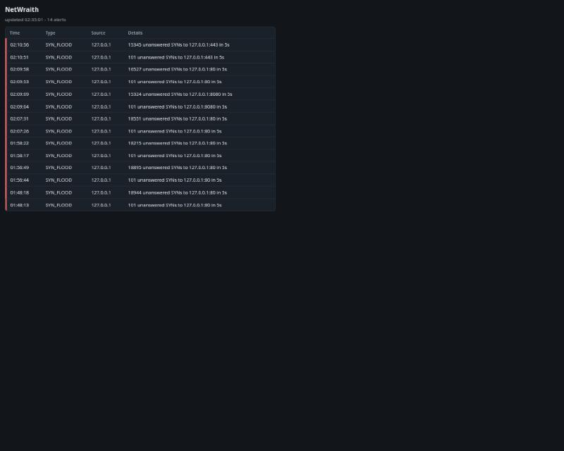

# NetWraith

A packet sniffer and intrusion detector for Linux, built from scratch in Python 3 with **no frameworks** — no Scapy, no Flask, no third-party dependencies. Raw sockets, hand-decoded Ethernet/IPv4/TCP/UDP headers, and four independent detection algorithms for port scans and SYN floods.


*Real screenshot — the dashboard reading `alerts.json`, populated by actual `hping3` flood trials against this project's own sniffer.*

**Full write-up, architecture diagram, byte-by-byte packet walkthrough, real test results, and an interview-prep kit:** [docs/BUILD-GUIDE.html](docs/BUILD-GUIDE.html)

## Why this exists

Most "packet sniffer" projects lean on a library (Scapy, dpkt) that hides exactly the part worth learning. NetWraith decodes every header field by hand with `struct.unpack` — down to testing a single TCP flag bit with a bitmask — so each line can be explained, not just imported.

It turned out to be useful for more than that — see **Ways to use this** and **Integrating it into your own app or site** below.

## How it works, in 5 lines

1. `sniffer.py` opens a raw `AF_PACKET`/`SOCK_RAW` socket and reads packets as they arrive.
2. `parse_packet()` decodes the Ethernet, IPv4, and TCP/UDP headers by hand into a plain dict.
3. Every packet is handed to four detectors: a fast port-scan detector (sliding 10s window), a slow bucketed one (10-minute window for patient scanners), a distributed one (groups by *victim*, not attacker, to catch many-IP scans), and a SYN-flood detector (per-service and global, to catch both single-IP and spoofed floods).
4. Any alert is appended to `alerts.json`, written atomically (temp file + `os.replace`) so readers never see a half-written file.
5. `dashboard.html` polls `alerts.json` every 2 seconds and renders a live table, in light or dark theme.

## Running it

### One command

```bash
sudo ./run.sh
```

This starts the dashboard's HTTP server in the background and the sniffer in the foreground — `ALERT` lines print straight to your terminal, and the dashboard is immediately at **http://127.0.0.1:8000/dashboard.html**. Ctrl-C stops both together. Pass a different port with `sudo ./run.sh 8080`.

### Manual (two terminals, if you want to watch each piece separately)

```bash
# terminal 1 — needs root for the raw socket
sudo python3 sniffer.py

# terminal 2
python3 -m http.server --bind 127.0.0.1 8000
# open http://127.0.0.1:8000/dashboard.html
```

Detection thresholds are constructor defaults in `detect.py` (e.g. `ScanDetector(max_ports=20, window=10)`) — tune them for your own network's traffic volume.

## Ways to use this

- **A lightweight home/lab network monitor.** No install beyond Python 3's standard library, runs from one folder, `sudo ./run.sh` and you're watching your LAN.
- **A teaching artifact for networking courses.** Every byte offset in a real captured packet is documented in the build guide — a stronger classroom example than a Scapy one-liner, because nothing is hidden.
- **A blue-team baseline for CTF practice.** Point it at a CTF lab network during an attack-defense round; `alerts.json` is plain JSON, trivial to pipe into a scoreboard or a webhook (see below).
- **A base for IDS research.** The four detector classes (`ScanDetector`, `SlowScanDetector`, `DistributedScanDetector`, `FloodDetector`) are small, independently unit-tested, and built to be swapped or extended rather than inherited from a framework — a natural place to prototype a new detection heuristic without a large codebase in the way.
- **A portable incident-response companion.** No install beyond a Python 3 interpreter means it can be copied onto a box during an investigation for immediate visibility, without pulling in Suricata/Zeek.

## Integrating it into your own app or site

NetWraith's output (`alerts.json`) is plain JSON and its detectors are plain Python classes — neither is tied to the dashboard, so you can wire either into something else of your own.

### 1. Read `alerts.json` from any language

It's a static file on disk, written atomically. Anything that can poll a file or an HTTP URL can consume it:

```python
import json
with open("alerts.json") as f:
    data = json.load(f)
print(data["alerts"])   # list of alert dicts
print(data["stats"])    # {"TCP": N, "UDP": N}
```

Or, if you're already serving it over HTTP (as `run.sh`/`http.server` does), `fetch()` it from any web app, exactly like `dashboard.html` does:

```js
const res = await fetch("http://your-host:8000/alerts.json", {cache: "no-store"});
const data = await res.json();
```

### 2. Embed the live dashboard in another site

Since `dashboard.html` is a single self-contained file with no external dependencies, you can embed it directly:

```html
<iframe src="http://your-netwraith-host:8000/dashboard.html"
        style="width:100%; height:500px; border:0;"></iframe>
```

(Serve it over HTTPS and restrict access with a reverse proxy if it's reachable beyond your own LAN — `run.sh` binds to `127.0.0.1` only by default for exactly this reason.)

### 3. Forward alerts to Slack, a webhook, or a SIEM

The detectors don't know or care what happens to an alert after it's returned from `.process()`. A tiny watcher script can tail `alerts.json` and forward new entries anywhere:

```python
import json, time, urllib.request

seen = set()
while True:
    data = json.load(open("alerts.json"))
    for a in data["alerts"]:
        key = (a["type"], a["ts"])
        if key not in seen:
            seen.add(key)
            payload = json.dumps({"text": f"{a['type']} from {a.get('src','?')}"}).encode()
            urllib.request.urlopen(urllib.request.Request(
                "https://hooks.slack.com/services/XXX/YYY/ZZZ",
                data=payload, headers={"Content-Type": "application/json"}))
    time.sleep(2)
```

### 4. Use the detectors as a library in your own Python project

Each detector takes a packet dict and returns an alert dict or `None` — there's no dependency on `sniffer.py` at all, so you can feed it packets from your own capture pipeline (Scapy, a PCAP reader, a different NIC driver, etc.):

```python
from detect import ScanDetector, FloodDetector

scan = ScanDetector(max_ports=15, window=5)   # tune thresholds per-project
flood = FloodDetector(per_src_limit=50, global_limit=200)

for pkt in your_own_packet_source():
    for alert in (scan.process(pkt), flood.process(pkt)):
        if alert:
            handle_alert(alert)
```

`pkt` just needs the fields `parse_packet()` produces: `ts`, `src`, `dst`, `proto`, and for TCP also `sport`, `dport`, `flags`.

### 5. Run it as an always-on system service

For a monitor that survives reboots, wrap `run.sh` in a systemd unit:

```ini
# /etc/systemd/system/netwraith.service
[Unit]
Description=NetWraith packet sniffer and dashboard
After=network.target

[Service]
WorkingDirectory=/opt/netwraith
ExecStart=/opt/netwraith/run.sh 8000
Restart=on-failure

[Install]
WantedBy=multi-user.target
```

```bash
sudo systemctl enable --now netwraith
```

## Tested with

- `tests/test_scan.py`, `test_slow.py`, `test_distributed.py`, `test_flood.py` — synthetic-packet unit tests, all passing.
- Real `nmap -sS` scans and bounded `hping3 --flood` SYN floods against the author's own machine — **5/5 floods caught, 0 false alarms** (full numbers in the build guide).

## Known limitations

See [docs/BUILD-GUIDE.html](docs/BUILD-GUIDE.html) → *Testing & Results* / *Interview Kit* for the full, honest list — including that patient low-and-slow scanners can evade the current thresholds, only SYN-based TCP scans are detected (FIN/NULL/Xmas/ACK and UDP scans are not), and IPv6 is not yet decoded.

## Stack

Python 3 standard library only: `socket`, `struct`, `json`, `collections`, `time`. No external dependencies, no pip install required.
